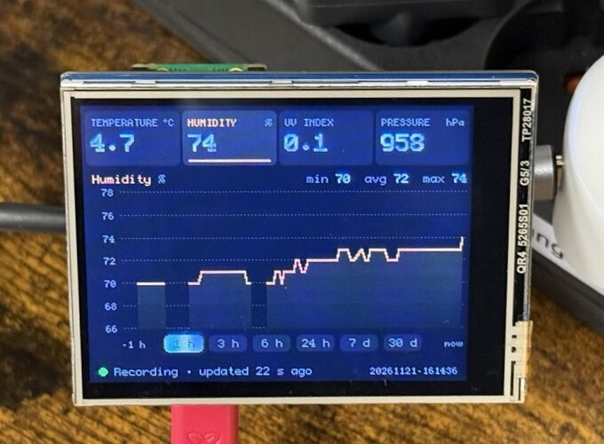
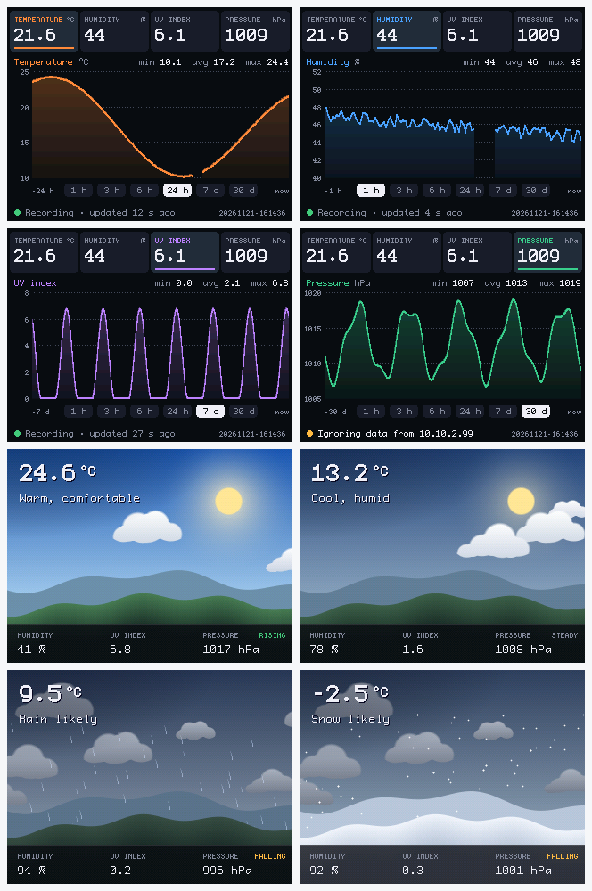
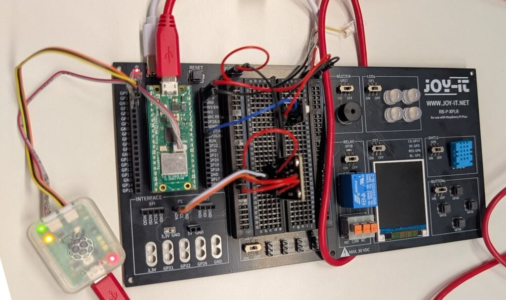
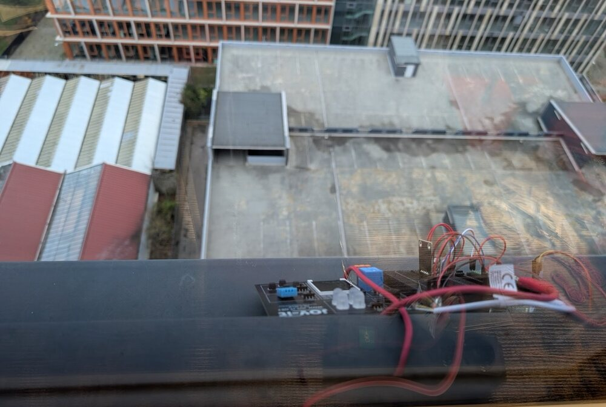

# Weather Station on the Raspberry Pi Pico W

Firmware for two devices built on the Raspberry Pi Pico W (RP2040), written in Rust with [Embassy](https://embassy.dev):

- **Weather station**, in `crates/apps/weather-station`, measures the temperature, the humidity, the UV radiation, and the air pressure every 30 seconds and shows them on its display.
- **Touch display**, in `crates/apps/touch-display`, is a Waveshare Pico-ResTouch-LCD-2.8 that receives the measurements over the local network, stores them on a microSD card, plots them, and animates the weather.

Both devices install new firmware [over the air](#over-the-air-updates), so that they can be fixed and improved wherever they are installed.





## Hardware

- A Raspberry Pi Pico W for each device and a 2.4 GHz Wi-Fi network, the only kind that the Pico W joins.
- For the weather station, a Joy-IT explorer board (RB-P-XPLR). The firmware uses its DHT11 sensor on GP0 and its 1.8" display on SPI0. Turn on their switches.
- A Joy-IT SEN-UV01 UV sensor: VCC to 3V3 (OUT), GND to GND, and OUT to GP26.
- A BMP280 pressure sensor, for instance, the Joy-IT KY-052: +V to 3V3 (OUT), GND to GND, SDA to GP4, and SCL to GP5. Tie CSB and SDO to 3V3, which select I2C and the address 0x77.
- For the touch display, a Waveshare Pico-ResTouch-LCD-2.8 and a microSD card with a FAT16 or FAT32 file system, the file system of most cards up to 32 GB. Plug in the Pico W with its USB port on the side of the microSD slot.



## Build and Flash

You need [Rust](https://rustup.rs), `python3`, `openssl`, and [`mise`](https://mise.jdx.dev). `rust-toolchain.toml` installs the target and tools that Rust needs. Before the first build, [set up updates](#set-up-updates), which also configures the Wi-Fi network.

```sh
mise run build weather-station
mise run build touch-display
```

The build writes `target/<crate>/<crate>.uf2`. The version of the firmware is the time of the build, for instance, `20261120-163751`. The UF2 file contains the Wi-Fi password and the credentials of the device, so do not share it.

To flash it, hold the BOOTSEL button while connecting the Pico W over USB and copy the UF2 file to the drive `RPI-RP2`. From then on, the device receives new versions over the air.

The firmware logs to the USB serial port, for instance, `/dev/ttyACM0`. Open it with a serial terminal such as `tio /dev/ttyACM0`.

The weather station can also run on its own, without Wi-Fi, updates, or the touch display, and only log its measurements. This variant needs no configuration:

```sh
mise run build weather-station -- --no-default-features
```

## Weather Station

The weather station shows the latest values on its display, with dashes for a sensor that failed. A measurement looks as follows:

```json
{
  "temperatureCelsius": 21.0,
  "humidityPercent": 45.0,
  "uvIndex": 0.21,
  "uvVolts": 0.021,
  "pressureHectopascals": 1013.2
}
```

The temperature and the humidity come from the DHT11 and the air pressure from the BMP280. The UV index is the voltage of the UV sensor divided by 0.1 V, an uncalibrated approximation. The pressure is the absolute pressure at the height of the device, lower than the pressure at sea level that weather reports quote. A sensor that fails is missing from the measurement. A missing UV sensor goes unnoticed, because the open analog input yields arbitrary voltages.

## Touch Display

The weather station sends every measurement right away as a UDP datagram to port 4242 of the touch display, with the time of the measurement and a sequence number. The touch display accepts measurements only from the weather station. Both devices learn the address of the other one through a [remote configuration](#configure-and-monitor-the-devices).

The display rotates through the plots of temperature, humidity, UV index, and air pressure for 10 seconds each and then the weather scene for 20 seconds:

- A tap on a tile at the top plots its quantity.
- A tap on a chip below the plot selects the interval: 1 hour, 3 hours, 6 hours, 24 hours, 7 days, or 30 days.
- A tap on the plot shows the next page, and a tap on the weather scene returns to the plots.
- After a tap, the page stays for a minute.

The line at the bottom shows the state of the device:

- **Recording · updated 12 s ago**, green: Measurements arrive and are stored.
- **Waiting for the weather station** or **No data for 3 min**, amber: No measurements arrive. Check the weather station and its configuration.
- **Ignoring data from 10.10.2.99**, amber: Measurements arrive from another address than the configured one.
- **No weather station configured**, amber: The address of the weather station is missing.
- **SD card failed, check the card**, red: The card is missing or cannot be written.

The weather scene animates the latest measurement. The weather station measures neither clouds nor rain, so the scene maps what it measures to a picture:

- The sun shines with a UV index of at least 1 and glows brighter the higher it is.
- Clouds grow with the humidity and turn dark from 85 %.
- Rain falls when the humidity is at least 90 % and the air pressure falls by at least 1 hPa over two to three hours, the classic barometric sign of worsening weather. At or below 1 °C, snow falls instead.
- The sky is icy and the hills are snowy at or below 0 °C, and the sky is warm from 25 °C.

### Stored Measurements

The touch display stores the measurements in one file per day, for instance, `LOG/2026/20261121.WSL`, which takes about 46 KB. It writes to the card at least every 5 minutes, so a power failure loses at most the last 5 minutes. `crates/apps/touch-display/src/format.rs` describes the format. To read the measurements on a computer, export them as CSV:

```sh
scripts/export.py /media/sdcard/LOG > measurements.csv
```

### Pins

The display, the touch controller, and the microSD slot share SPI1:

- SPI1: clock on GP10, data out on GP11, and data in on GP12.
- Display: data or command on GP8, chip select on GP9, backlight on GP13, and reset on GP15.
- Touch controller: chip select on GP16 and interrupt on GP17.
- microSD slot: chip select on GP22.

The touch screen uses the calibration of Waveshare's example code. Calibrations vary between panels, so the targets on the screen are large, and the log records the position and target of every tap.

## Over-the-Air Updates

A weather station is often installed where nobody wants to go: on a roof, on a mast, or in a garden on the other side of town. Its firmware still needs to change after installation, to fix bugs, to support a new sensor, or to send its data elsewhere. Without over-the-air updates, every such change means a trip to the device and a USB cable.



Both devices update themselves over Wi-Fi through [Nexigon](https://nexigon.cloud), a platform for managing devices and their software. You build a new firmware, publish it as a version of a package, and the devices install it on their own:

- **Signed.** A device installs only firmware signed with your release key.
- **A/B slots.** A device downloads an update into a second slot while the current firmware keeps running. Only a complete, verified update replaces it.
- **Automatic rollback.** A new firmware must reach Nexigon Hub within 5 minutes to commit itself. Otherwise, the bootloader restores the previous firmware, so a firmware that crashes, hangs, or cannot connect is replaced by the one before it.
- **Power-safe.** A power failure while the bootloader swaps the slots resumes the swap on the next start.
- **Controlled rollout.** Devices follow a version path, such as the tag `latest` of a package. A single device can be pinned to a version or held back.
- **Visible progress.** Each device reports each step of an update, and any failure, to Nexigon Hub.

### Set Up Updates

For releases, you need the [Nexigon CLI](https://docs.nexigon.dev) and an organization API token.

Create the key with which updates are signed. Keep the private key in `keys/` private: whoever has it can install their own firmware.

```sh
mise run create-release-key
```

Create the identity of each device, a key and a certificate in `crates/apps/<crate>/identity/`. Every board needs its own identity, and whoever has it can act as the device.

```sh
mise run provision weather-station
mise run provision touch-display
```

Configure the firmware in `mise.local.toml`, which Git ignores:

```toml
[env]
NEXIGON_HUB_URL = "https://nexigon.example.com"
NEXIGON_DEPLOYMENT_TOKEN = "deployment_..."
WIFI_SSID = "..."
WIFI_PASSWORD = "..."
# Version paths from which the devices install updates.
WEATHER_STATION_UPDATE_PATH = "default/rp-sensors/latest"
TOUCH_DISPLAY_UPDATE_PATH = "default/rp-display/latest"
# Only needed for releases.
NEXIGON_ORG_TOKEN = "org_sk_..."
```

The firmware embeds this configuration, its identity, and the public release key. On its first connection, Nexigon Hub registers the device in the project of the deployment token.

### Release an Update

Each kind of device has its own package, so that a device only installs its own firmware: `rp-sensors` for the weather station and `rp-display` for the touch display. Build and publish a new version:

```sh
mise run build weather-station
mise run release weather-station default/rp-sensors
```

The release uploads the firmware and its signature as a new version of the package, tags it with the firmware version, and moves the tag `latest` to it. Devices that follow `latest` install it within 5 minutes, or right away with the command `nexigon.ota.check`. An update takes a few minutes.

The `dev.nexigon.ota.config` property of a device overrides its version path. For instance, `{"path": "default/rp-sensors/20261120-163751"}` pins a version, and `{"hold": true}` holds updates. The device reports its progress in the `dev.nexigon.ota.status` property.

### How Updates Work

The flash, as `firmware.x` describes it, holds the bootloader (24 KiB), the state of the bootloader (4 KiB), the active slot with the running firmware (1008 KiB), and the DFU slot for a downloaded update (1012 KiB). The bootloader in `crates/apps/bootloader` is based on `embassy-boot`.

The firmware follows the OTA update contract of Nexigon Hub. It reads the desired version from the configuration, downloads the firmware and its signature into the DFU slot, verifies the signature, and resets. The bootloader swaps the slots and starts the new firmware, which commits itself once it reaches Nexigon Hub. If it does not within 5 minutes, the watchdog resets the device, and the bootloader swaps the old firmware back.

The firmware keeps one TLS connection to Nexigon Hub open, because the RP2040 has no hardware acceleration for the cryptography of a handshake. The code is in `crates/libs/pico-platform/src/nexigon/`, behind the `nexigon` feature. Its API types are generated with Sidex. To regenerate them, run `mise run generate:api ../nexigon` with a checkout of the public `nexigon` repository.

### Configure and Monitor the Devices

Two device properties configure the IP addresses. Each device reads its property every 30 seconds, so a change takes effect without a new firmware:

```sh
nexigon-cli devices properties set --protected true <device-id> weather-station.config '{"displayAddress": "10.10.2.28"}'
nexigon-cli devices properties set --protected true <device-id> touch-display.config '{"sensorAddress": "10.10.2.51"}'
```

`displayAddress` is the address to which the weather station sends its measurements, and `sensorAddress` the only address from which the touch display accepts them. Only Nexigon Hub can change a protected property, not the device itself.

Every 30 seconds, each device publishes a `heartbeat` event with its uptime, its firmware version, and its IP address. The weather station adds an `environment` event with its latest measurement. The touch display adds a `storage` event that counts the measurements stored on the card, those not on the card yet, those it dropped, the datagrams it rejected, and the datagrams that never arrived.

Both devices offer three commands on their page in Nexigon Hub: `set-led` with `{"on": true}`, `get-status`, and `nexigon.ota.check`. To add a command, extend `crates/libs/pico-platform/src/nexigon/commands.rs`.

### Limitations of Updates

- A firmware that reaches Nexigon Hub commits itself, even if it breaks later updates, for instance, through a bug in the application. Such a firmware must be replaced over USB.
- The firmware does not verify the certificate of the server, which takes the RP2040 longer than Nexigon Hub waits for a handshake. A man-in-the-middle could learn the deployment token, but the signature of updates prevents them from installing their own firmware.
- The private key of the device is stored in flash, from which anyone with physical access can read it.
- The firmware supports the version path, `hold`, and `asset` of the OTA update contract, but no maintenance windows or spreading of updates. It does not retry a failed update on its own.
- Reading the flash with a debugger while the firmware writes an update corrupts the update.

## Repository

The repository is a Cargo workspace:

- `crates/apps/bootloader`: Bootloader that swaps in updates and rolls them back.
- `crates/apps/weather-station`: Firmware of the weather station.
- `crates/apps/touch-display`: Firmware of the touch display.
- `crates/libs/pico-platform`: Watchdog, USB logger, and, with the `nexigon` feature, Wi-Fi and over-the-air updates.
- `crates/libs/pico-build`: Helpers for the build scripts of the firmware crates.

The module documentation of each crate describes its parts.

## Limitations

- The touch display identifies the weather station by its IP address only, so any device in the network can send it measurements from that address.
- Datagrams are not acknowledged, so measurements are lost while the touch display is unreachable. The `storage` events count them.

## License

The firmware is licensed under either of [Apache License, Version 2.0](LICENSE-APACHE) or [MIT License](LICENSE-MIT) at your option. Two parts keep their own licenses:

- The Wi-Fi chip firmware in `crates/libs/pico-platform/firmware/cyw43/` comes from [`cyw43-driver`](https://github.com/georgerobotics/cyw43-driver/tree/main/firmware) and is licensed under the [Infineon Permissive Binary License](crates/libs/pico-platform/firmware/cyw43/LICENSE-permissive-binary-license-1.0.txt).
- The patched `embedded-tls` in `vendor/embedded-tls/`, which `vendor/README.md` explains, is licensed under the [Apache License, Version 2.0](vendor/embedded-tls/LICENSE).
